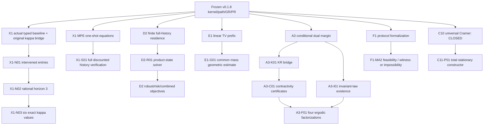

# PermanssonLean — complete documented mathematical closure atlas
**Audit date:** 18 October 2026  \  **Live main:** `39279799834ae536bda715dedecdc11a32bf6c82`  \  **Verification basis:** repository trees, 395-module research library, 64-module frozen core, 17-claim accepted research companion, active implementation index, all lane ledgers, Appendix E README.

**Status definitions.** Level I = explicit outstanding mathematics/bridges in the accepted v0.2.0 crosswalk or implementation index, decomposed into implementable work packages; Level II = additional documented mathematical extensions not required by the accepted release; Level III = optional specialized-paper transfers with no asserted universal theorem. A mathematical task being Level I does **not** mean v0.2.0 was improperly released.

## Source-authority and reproducibility notes

- The uploaded historical source ZIP reproduces current `main` Git tree hashes for `PermanssonLean/` (`252cae4955bfb8f6440567a5186398bb1967a24c`), `PermanssonResearch/` (`f40d38fd0c0e836f73d4f6f64e66b876ff31fd1c`), `paper/`, `provenance/`, and `application/`. Thus the mathematical sources are current despite the later maintenance-only commits.
- This is a read-only source audit; it does **not** constitute new Lean compilation, a proof, external scholarly review, or an empirical certification.
- Directly source-confirmed completed math includes original kernel/path/GR/PR, CQ1, B1–B13, finite recurrent-class/observed-family results, C10 universal Dirichlet acceptance and canonical event bridge, C11 checked stationary-family transport, D0/D1/D2 stated finite objectives, C69/C70, A2 additive primitive TV, B2 sequential comparisons, E1 linear finite prefix, F1 conditional-product protocol/obstruction, A3 conditional dual, and X1 scoped equilibrium/occupation/negative GR. None should be represented as missing simply because an upstream historical file says “future”.
- C10 closed proof declarations: `RationalCramerCertification.referenceDirichlet_check_true`, `TypedStoppedClassAbsorption.cramerWeight_eq_typedStoppedClass_probability`, and `TypedObservedCramerCorrespondence` true path-event bridge. This is distinct from a **C11** generic stationary *generator* theorem, which is still absent.
- A3 bounded-diameter TV→dual-W₁ is already `KantorovichTV.W1DualLE.of_eventTV`, and it has an unbounded-metric counterexample `tv_does_not_control_w1_on_real`. The outstanding A3 bridge is about full coupling/KR identification, primitive metric estimates under genuine hypotheses, and ergodic factorization—not reproving that established conversion.
- Fixed X1 `B = Memory × {true}` is provably leaky for both generators; `h=x` is also constant on B. **Do not** list “make the old X1 a successful Exact-GR” as a missing proof. A positive example would be a new prospectively specified model.

## Counted open-project taxonomy

- **Level I: 12** — explicit open or accepted-scope bridge.
- **Level II: 25** — documented optional additional formalization.
- **Level III: 5** — optional specialized transfer, not a contracted universal theorem.

The 12 Level-I entries are **work packages**, not 12 mutually independent axioms. In particular, three tasks implement one X1 numerical-certificate closure, and four tasks are supporting bridges for the broader A3 claim.

## Level I — direct mathematical closure obligations

### X1-N01 — Actual intervention atom reification  (X1; P0)
**Already proved:** X1.TypedModels.inducedKernel_atom_entry proves baseline typed atoms; Comparison.lean defines Jaction/Jupdate/Jjoint.
**Missing theorem/bridge:** Derive finite rational entries for ALL 3 actual interventions in both modes and connect them to J.intervention.apply.inducedKernel on all 18 states..
**Required hypotheses/scope:** Identical physical P; alpha-P-U order; old-world learner update; reset affects next memory only..
**Proof and falsification acceptance:** Corrupt world row, old/new-world update order, action timing, reset, and intervention name; proof must be tied to typed J..
**Repository reference:** `PermanssonResearch/X1/TypedModels.lean; PermanssonResearch/X1/Comparison.lean`.

### X1-N02 — Finite-horizon rational reflection  (X1; P0)
**Already proved:** FiniteOutputs.lean proves primitiveTerminal_eq_kernelTerminal for baseline, and baselineProperty_eq_kernelTerminal for all typed models.
**Missing theorem/bridge:** Bridge time-three kernelTerminal for baseline and ALL intervened kernels to exact rational finite recursions, and certify all nine initial rows..
**Required hypotheses/scope:** Same predeclared property P(X_3=true), terminal re-entry allowed; no killed-kernel substitution..
**Proof and falsification acceptance:** 18-state exhaustive exact rational row checks; perturb one value / wrong horizon; compare to independent Python paths..
**Dependencies:** X1-N01.
**Repository reference:** `PermanssonResearch/X1/FiniteOutputs.lean`.

### X1-N03 — All six original numerical margins  (X1; P0)
**Already proved:** constitutiveEffect_eq_finiteEffect and constitutiveMargin_eq_finiteInf prove exact semantic correspondence.
**Missing theorem/bridge:** Prove six equalities of ORIGINAL constitutiveMargin with 271/800, 0, 271/800; 3010663529/6400000000, 1244820951/25600000000, 3010663529/6400000000..
**Required hypotheses/scope:** Entire nine-start comparison B1; show lower bounds at all starts and attainment at a genuine start; no Exact-GR/PR promotion..
**Proof and falsification acceptance:** Exact negatives for dropping one start; show E all starts tie; learner minima q=(0,0) for action/joint, q=(2,2) for update..
**Dependencies:** X1-N02.
**Repository reference:** `PermanssonResearch/X1/FiniteOutputs.lean; docs/LANE_X1_COMMONS.md`.

### X1-S01 — Unrestricted discounted-strategy verification  (X1; P0)
**Already proved:** MPECertificate.lean proves both-player Bellman, pure/mixed one-shot, support; typed E uses same world.
**Missing theorem/bridge:** Prove candidate discounted value and no profitable unilateral nonanticipating history-dependent behavioral deviation, with genuine expected-payoff/path bridge..
**Required hypotheses/scope:** Fix observed information incl state/action histories; bounded rewards, beta=9/10, opponent baseline fixed, off-equilibrium starts, stage payoff availability (actions not on state path)..
**Proof and falsification acceptance:** Finite-horizon Bellman dominance telescopes; tail bound; optimality for every allowed policy and both players; failure of unbounded or clairvoyant strategies outside class..
**Repository reference:** `PermanssonResearch/X1/MPECertificate.lean; docs/LANE_X1_COMMONS.md`.

### F1-MA2 — Strict opponent-locked MA2 feasibility and resolution  (F1; P1)
**Already proved:** ProtocolWitnesses.lean proves broader nonstrict anchor example, strict MA1, and a deterministic-recording obstruction.
**Missing theorem/bridge:** Either give a valid pair of strict baseline-agreeing OL anchors with distinct intervened full path laws, OR prove a general impossibility for the exactly declared strict subclass and record corrected claim status..
**Required hypotheses/scope:** Anchor factorization through own S2 and permissible exogenous S0; common update cannot launder treated action; baseline-support agreement and reachable states exact..
**Proof and falsification acceptance:** Reject reactive anchorWorld, endogenous public clock, baseline-support undercoverage and inadmissible anchors; distinguish witness from impossibility proof..
**Repository reference:** `PermanssonResearch/MultiAgent/Protocols.lean; docs/LANE_F1_MULTIAGENT_PROTOCOLS.md`.

### E1-G01 — Geometric projected-prefix TV envelope  (E1; P2)
**Already proved:** ApproxPrefix.lean proves TV_T<=min(1,T*eta); EventTVCalculus covers triangle/product operations.
**Missing theorem/bridge:** Prove TV_T <= 1-(1-eta)^T in an explicitly measurable subclass with genuine shared-mass or coupling induction..
**Required hypotheses/scope:** Defect bounds on every fine row incl counterfactual-reachable; typed q, matched starts; do not assume projected process is Markov..
**Proof and falsification acceptance:** Counterexample for non-Markov fine projection, eta=0/1, and vacuous horizons; prove common-mass measurability, not just analytic telescoping..
**Repository reference:** `PermanssonResearch/Quotient/ApproxPrefix.lean; docs/LANE_E1_APPROX_QUOTIENT.md`.

### A3-K01 — Coupling W1 = Lipschitz-dual bridge  (A3; P1)
**Already proved:** ContractiveOccupation.lean proves bounds for W1DualLE over bounded measurable 1-Lipschitz tests.
**Missing theorem/bridge:** Prove Kantorovich–Rubinstein identification with coupling W1, or a sound one-way comparison sufficient for each desired statement..
**Required hypotheses/scope:** Add appropriate Polish/Radon/finite first-moment premises; handle unbounded metrics without silently requiring global sup-norm <=1..
**Proof and falsification acceptance:** Atomic finite examples; metric test classes; no false TV-to-W1 equivalence on unbounded metrics..
**Repository reference:** `PermanssonResearch/Perturbation/ContractiveOccupation.lean; docs/LANE_A3_CONTRACTIVE.md`.

### A3-I01 — Invariant-law existence and uniqueness  (A3; P1)
**Already proved:** Existing contraction assumes invariant pi and pi-tilde and finite initial dual gap.
**Missing theorem/bridge:** Prove existence/uniqueness of invariant laws under an explicit complete metric/Feller/contractive or finite-state irreducible subclass..
**Required hypotheses/scope:** No existence from invariance identity alone; decide whether both compared kernels contract or only baseline K does..
**Proof and falsification acceptance:** Identity/multiclass countermodels without hypotheses; chain convergence with independently established invariant law..
**Repository reference:** `docs/LANE_A3_CONTRACTIVE.md`.

### A3-C01 — Primitive or sufficient-condition contraction certificates  (A3; P2)
**Already proved:** ContractivePerturbation assumes IsW1Contraction; current A3 proof does not derive it.
**Missing theorem/bridge:** Establish explicit sufficient conditions such as finite-space Doeblin/Dobrushin or metric coupling which imply the actually encoded dual contraction..
**Required hypotheses/scope:** TV contraction does not imply unqualified W1 contraction on unbounded metrics; include diameter or direct metric bound..
**Proof and falsification acceptance:** Small finite kernels that do/not contract; check rho<1 as proved data, not relabeled input..
**Dependencies:** A3-K01 for coupling interpretation.
**Repository reference:** `docs/V020_IMPLEMENTATION_INDEX.md#A3`.

### A3-F01 — Four genuine full-path ergodic factorizations  (A3; P1)
**Already proved:** occupationMargin_robust assumes all four psi(pathLaw_y)=F(h_#pi) identities on B1.
**Missing theorem/bridge:** Derive factorization from a certified ergodic/occupation convergence theorem in a suitable subclass for original baseline, its intervention, perturbed baseline, and perturbed intervention..
**Required hypotheses/scope:** Correct start quantifiers, measurable Lipschitz descriptor and property functional; do not infer path values from invariant laws without ergodicity..
**Proof and falsification acceptance:** Mixed-class and nonergodic counterexample; four-process exhaustive hypotheses and direct original property equality..
**Dependencies:** A3-I01; appropriate occupation convergence.
**Repository reference:** `PermanssonResearch/Perturbation/ContractiveOccupation.lean; docs/LANE_A3_CONTRACTIVE.md`.

### A3-P01 — Primitive metric kernel error to W1 defect  (A3; P2)
**Already proved:** A2 derives primitive row event-TV; KantorovichTV.lean ALREADY proves bounded-diameter dual W1 <= D*TV and unbounded-metric noncontrol; A3 assumes row W1DualLE defects.
**Missing theorem/bridge:** Prove a typed alpha/P/U-to-row metric defect certificate (or coupling certificate) with the correct Lipschitz and/or diameter premises; reuse rather than reprove the bounded-diameter conversion..
**Required hypotheses/scope:** Changed P across compared models is model error, not a strategic intervention within each model; no universal TV to W1 on unbounded metrics..
**Proof and falsification acceptance:** Degenerate/large-diameter counterexamples, off-graph and unreachable baseline rows, stage-order mutation..
**Dependencies:** A3-K01 for coupling form; A2 primitive laws.
**Repository reference:** `docs/PERMANSSON_V020_MATHEMATICAL_INTEGRATION_SPEC.md`.

### D2-R01 — Augmented-state residence Bellman sufficiency  (D2; P1)
**Already proved:** ResidenceEvent and ResidenceValue prove literal path event and optimum over deterministic full-history policies.
**Missing theorem/bridge:** Define compact state (physical y, streak/clock, completed flag, time) and prove evaluator and optimal value equal existing full-history one..
**Required hypotheses/scope:** m transitions = m+1 observations; starting target counts; retries; entry vs completion deadline; no physical absorbing rewrite..
**Proof and falsification acceptance:** Hitting-vs-residence counterexample; time-zero, m=0, retrial, off-by-one, full-history equality and attainment..
**Repository reference:** `PermanssonResearch/ReverseSolver/ResidenceEvent.lean; ResidenceValue.lean; docs/D2_RESIDENCE_OBJECTIVE.md`.

## Key exact formulas for the immediate proofs

For X1, the terminal effect must be tied to the actual typed replacement kernel; the existing theorem supplies

\[\kappa_{m,J}=\inf_{y\in B_1}\operatorname{dist}\bigl(\psi(P_y^{m}),\psi(P_y^{m,J})\bigr),\qquad B_1=\{((q_1,q_2),\mathrm{true}):q_i\in\{0,1,2\}\}.\]

The six proposed numerical certificates are

| Generator | action | update | joint |
|---|---:|---:|---:|
| E | `271/800` | `0` | `271/800` |
| L | `3010663529/6400000000` | `1244820951/25600000000` | `3010663529/6400000000` |

For E1, the accepted bound is `TV_T ≤ min(1,Tη)`; the stronger `TV_T ≤ 1-(1-η)^T` remains independent. For A3, the accepted result bounds the *dual-form* invariant-law discrepancy by `δ/(1-ρ)` under **supplied** invariants/contraction/finite gap; its four-process original-margin consequence requires **assumed** `ψ(P_y)=F(h_#π)` identities, not a derived ergodic theorem.

## Level II — documented deeper mathematical programme (not release blockers)

### A2 (2 tasks)
- **A2-P01 — Sharper sequential primitive product TV.** Show delta_K<=1-(1-delta_alpha)(1-delta_P)(1-delta_U) by sequential common-part/coupling construction. *Scope:* Measurable overlap at each stage under actual alpha-P-U sequence; uniform row bounds. *Adversarial gate:* Examples saturating product; nonindependent stages; preserve off-graph rows.
- **A2-P02 — Localized/initial-law and numerical-output budgets.** Derive a separately specified reachable-state or initial-distribution sensitivity theorem, plus any further identified numerical-model uncertainty transport not already in PropertyErrors. *Scope:* Do not silently replace true model margins by approximate reported outputs; control visit probability and initial law mismatch explicitly. *Adversarial gate:* Counterexample with unvisited baseline row becoming intervention-reachable; adversarial initial-law shifts.

### E1 (2 tasks)
- **E1-P01 — Nonfinite/whole-path output transport.** Build a property-level whole-path comparison with separately proved output-error budgets, if a relevant class admits it. *Scope:* Non-Lipschitz tail/survival not stable under tiny TV errors; no automatic Exact-GR preservation. *Adversarial gate:* Leakage counterexample; horizon dependence; missing property factorization.
- **E1-P02 — Conditional regime transfer under approximate quotient.** In an explicit subclass, prove full original GR/PR correspondence only when independent invariance, convergence, basin/descriptor/relevance and lift gates are separately established. *Scope:* No theorem can promote Exact GR merely from eta>0 and positive margin. *Adversarial gate:* Two-state leakage falsifier, non-saturated region, hidden descriptor, nonliftable initial laws.

### F1 (7 tasks)
- **F1-P01 — Swap treated player to player 2.** Formalize player-2 CL/OL typed replacements and the same actual canonical path/margin bounds. *Scope:* Product coordinate swap must respect P and common S0; no silent symmetry with asymmetric player input. *Adversarial gate:* Asymmetric worlds and private-update regression.
- **F1-P02 — General finite n-player product protocol.** Define finite-index action/update kernels and i-th-player interventions with measurable products and original family admissibility. *Scope:* Subclassification explicitly product-conditional; correlated moves need separate treatment. *Adversarial gate:* Reduce to n=2 and asymmetric n=3 examples, show same P and frozen update. *Depends:* F1-P01 optional
- **F1-P03 — Typed nonstationary/open-loop clock.** Embed clock in an actually updated permissible state coordinate and prove horizon-indexed anchor behavior under canonical path laws. *Scope:* No access to disallowed player-1/action/world channels in strict protocol; common clock only if exogenous. *Adversarial gate:* Period-2 action witness; static-anchor false positive; excluded endogenous clock.
- **F1-P04 — Feasible opponent-anchor menus.** Give a typed feasible-action predicate and prove closed/open generators preserve supported feasible actions. *Scope:* Feasible graph measured and component-wise; nonempty menus. *Adversarial gate:* Force illegal action and reject; all legal actions give an admitted anchor.
- **F1-P05 — General nonreactivity/exogeneity characterization.** Develop a necessary-and-sufficient criterion (if possible) for counterfactual opponent independence under declared information flow. *Scope:* Do not equate local nonworld-reading with absence of endogenous S0 response. *Adversarial gate:* Path through S0 encodes treated action; random shared-coin positive example.
- **F1-P06 — Correlated nonproduct strategic generators.** Formalize explicit correlated/private-public signal subclass or alternative joint kernels with declared shared information. *Scope:* No universal factorization without sufficient latent variable/state. *Adversarial gate:* A perfectly correlated Boolean law, independence falsifier, shared exogenous coin.
- **F1-P07 — Identified causal-adaptation decomposition.** Only with a separately specified structural counterfactual/identification model, prove a causal decomposition or formal nonidentification result. *Scope:* Require modularity, support, anchor legitimacy and observational regime; never rename protocol gap causal effect. *Adversarial gate:* Distinct SCMs with same observed law but different mediation; compare intervention semantics.

### D2 (9 tasks)
- **D2-P01 — Randomized-history-policy sufficiency.** Prove a deterministic optimal policy suffices for finite fully observed expected residence reward under explicitly allowed randomized policies, or characterize when not. *Scope:* Declare behavioral randomization model and independence; avoid robust minmax where mixing helps. *Adversarial gate:* One-model finite expected reward vs model-uncertain robust counterexample. *Depends:* D2-R01 helpful
- **D2-P02 — First-ever-entry residence semantics.** Create separate first-ever-entry-only objective and corresponding event/recursion, proving difference from retryable objective. *Scope:* Time-zero entry, deadlines and no retries must be explicitly defined. *Adversarial gate:* Initial hit followed by failure and later success rejected by first-entry objective.
- **D2-P03 — Combined reach/avoid/residence optimization.** Define one finite-path event with forbidden precedence and residence, prove dynamic programming value and canonical event bridge. *Scope:* Freeze whether forbidden entry before/after success counts; no accidental absorbing dynamics. *Adversarial gate:* Cases with forbidden crossing after partial residence and simultaneous target/forbidden memberships. *Depends:* D2-R01
- **D2-P04 — Hard risk-constrained optimal policy.** Prove finite policy optimization with P(forbidden)<=rho and success objective, with exact risk state or appropriate LP/occupation certificate. *Scope:* Hard risk is distinct from failure probability and value may require randomized controls. *Adversarial gate:* Reject unconstrained optimizer with excess risk; rational admissible optimal policy. *Depends:* D2-P03; D2-P01 may be needed
- **D2-P05 — Robust dynamic programming with quantified nature.** Prove policy-state robust recursion in a precisely specified rectangular model; model-commitment/nonrectangular cases need separate methods. *Scope:* Nature observation/order and model switching information explicitly modeled; avoid interchanging quantifiers. *Adversarial gate:* One-decision minmax counterexample; nonrectangular uncertainty failing local Bellman.
- **D2-P06 — Partial observation and belief-state reduction.** Define observation kernels, belief filtering and prove any claimed belief-state sufficiency/optimality theorem. *Scope:* Identifiability and policy access to observations; no future observations. *Adversarial gate:* Two histories with same observation but different hidden state; compare belief-path laws.
- **D2-P07 — Finite-to-infinite reach-and-stay or viability.** Prove a conditional infinite-retention/switching objective under controlled invariance/viability or almost-sure tail conditions. *Scope:* Infinite stochastic leakage invalidates naive finite-horizon limit argument. *Adversarial gate:* Tiny-leak chain with finite residence success but infinite survival zero.
- **D2-P08 — Grammar-block adaptive control.** Define block control menus with admissible joint alpha/U semantics, then prove typed path/optimum correspondence. *Scope:* All block constraints and P preservation maintained; no implicit policy interpretation as fixed intervention. *Adversarial gate:* Overlapping patches rejected; synergistic joint-only test.
- **D2-P09 — Optimize class-entry or asymptotic observed family.** Prove finite controlled class selection/occupation-target objective and policy verification (under valid stationary or product-clock assumptions). *Scope:* Asymptotic law vs finite hitting; predeclare target family and supports. *Adversarial gate:* Same descriptor target from distinct physical classes; class weights vs occupation share.

### C11 (1 tasks)
- **C11-P01 — Total generic rational stationary reference solver.** Formalize a deterministic referenceStationaryFamily(K) and prove checkStationaryFamily K (referenceStationaryFamily K)=true for every valid nonempty rational K. *Scope:* Need constructive exact stationary vectors on each BSCC, rational linear-algebra nonsingularity and proof against genuine typed stationary measures. *Adversarial gate:* Wrong class, duplicate, missing class, singular rows, periodic class and corrupted rational weights.

### C (1 tasks)
- **C-P01 — General-state multiple-limit classification.** Develop conditional nonfinite-state/random-set/weak-cluster-point regime family semantics only with tightness/measurability/convergence hypotheses. *Scope:* No theorem guarantees occupational convergence in arbitrary measurable or infinite-state systems. *Adversarial gate:* Growing-block nonconvergence, noncompact escaping mass and observed-collapse countermodels.

### B (2 tasks)
- **B-P01 — Overlapping and conflicting component blocks.** Specify conflict-resolution or compatibility algebra for overlapping alpha/U patches and prove path-law/constitutive preservation or counterexample. *Scope:* Do not assume independently admissible components compose under overlap. *Adversarial gate:* Same row patched two ways, order-dependence and infeasible joined blocks.
- **B-P02 — General grammar lattice / minimality transport.** Characterize stronger transport/closure theorems for broader permitted blocks, if structurally sound. *Scope:* Do not assume uniqueness of minimal block or arbitrary bijection preserving inclusion. *Adversarial gate:* AND two incomparable minima, XOR nonmonotonicity, equal margins yet different subblock ordering.

### X1 (1 tasks)
- **X1-P01 — Separate genuine economic Exact-GR/PR positive witness.** Construct a NEW preregistered finite economic model with independently proved all Exact-GR, descriptor, basin, grounding and actual constitutive gates; retain old X1 negative witness untouched. *Scope:* Cannot repair the fixed X1 B merely with margin arithmetic; needs new model or an independently frozen new specification. *Adversarial gate:* Leakage, descriptor degeneracy, invalid singleton B1 and chosen ex-post region counterexamples.

## Level III — optional Appendix E specialized transfers

These are not commitments that the general GR/PR theorems will ever hold for arbitrary specialized Weil–CCM constructions. A transfer needs an explicit matched subclass, every specialized premise and a separate Lean proof.

- **APP-E01 — Scalar-defect transfer.** Define a matching Permansson representation class and prove the low-rank/scalar defect reduction in that class. *Preconditions:* Requires explicit linear/quadratic rigidity assumptions; not universal GR/PR.
- **APP-E02 — Persistent finite detection transfer.** Define nested legal approximants and prove detection transfer under continuity and nesting assumptions. *Preconditions:* No blanket finite detection for discontinuous infinite objects.
- **APP-E03 — First-bad cubic quotient transfer.** Derive successor quotient-dimension obstruction within an explicitly matched Permansson subclass. *Preconditions:* Scalar only if quotient dimension equals one.
- **APP-E04 — Singular compatibility transfer.** Formalize kernel/range compatibility when a relevant predecessor/response map is singular. *Preconditions:* Do not apply unjustified inverse/pseudoinverse.
- **APP-E05 — Quadratic Gram-witness transfer.** Transfer separating direction and perturbation margin in a defined signed-rank-one quadratic subclass. *Preconditions:* Requires Gram witness and class-specific quadratic assumptions.

## Scope firewalls: things which are not mathematically missing

1. **C10 exact rational absorption is proved:** do not reopen `referenceDirichlet_check_true` or the typed infinite canonical event bridge.
2. **C2–C5 finite recurrent-class occupation and sharp observable families are proved** within their encoded spaces/hypotheses. An unrestricted arbitrary-state theorem needs new topological/recurrence premises; it is not a missing unconditional finite-chain lemma.
3. **A3 bounded diameter TV-to-dual-W₁ already proved**; only the coupling/KR/general-primitive parts remain.
4. **X1 Exact GR failure is proved** and distinct occupation targets are formally identified. Numerical margins cannot rescue its region or descriptor gates.
5. **D2 full-history finite residence optimum is proved**. What remains is efficient reduction or a genuinely expanded control/uncertainty class.
6. **B grammar, C10 and C11 checked stationary-family receipt, A2/B2, C69/C70 and E1 finite linear statements** have real accepted declarations; do not reproduce them as hypothetical future requirements.
7. **Identification, statistical coverage, preregistration authenticity, real-world regime validity, safety and causal data quality** are not supplied by more Lean theorems. They need distinct empirical/model-assumption programmes.

## Mathematical dependency graph

## Candidate next PR order (numbers indicative, not yet opened)

| Sequence | Narrow closure | Deliverable | Go/no-go criterion |
|---|---|---|---|
| #79 | X1-N01 | Intervened alpha/P/U finite kernels and exact rational row correspondence | Actual J and all-state fixed-P equality; negative time-order mutations |
| #80 | X1-N02–N03 | Horizon-three reflection and six original kappa values | Full nine-start min/attainment, exact Lean compiler evidence, no PR promotion |
| #81 | X1-S01 | Discounted behavioral-history strategy verification | Trace semantics, Bellman telescoping and bounded discount tail for both players |
| #82 | D2-R01 | Compact residence clock Bellman theorem | Event/value/policy equivalence to existing full-history optimum |
| #83 | C11-P01 | General rational class stationary constructor | Proved checker total-success on all valid finite rational inputs |
| #84 | E1-G01 | Measurable common-mass prefix-TV bound | Precise added assumptions; full geometric theorem or documented impossible countermodel |
| #85 | F1-MA2 | Strict MA2 scope/feasibility theorem | Valid witness or justified impossibility under unchanged strict semantics |
| #86 | A3-K01 | Coupling/KR bridge with moment hypotheses | Actual coupling distance equals/controls encoded dual, no broad unlabeled generality |
| #87 | A3-I01 + A3-C01 | Invariant/contraction sufficient conditions | No invariant/exogeneity theorem assumed as part of conclusion |
| #88 | A3-F01 | Four-process ergodic property bridge | Derive each original full-path factorization rather than assuming it |
| #89+ | A2/E1/F1/D2 extended subclasses | Only separately scoped optional obligations | New theorem contract plus countermodels before implementation |

**Parallelization:** X1 numeric and X1 full strategy are logically independent after the accepted X1 base, though both consume the typed world. D2, E1, C11 and F1 can run independently of one another. A3 KR/invariant/sufficient-condition work should precede any attempt to promote an unconditional long-run margin theorem.

## Verification acceptance policy for all mathematical PRs

1. Freeze exact hypotheses, quantifiers, original property and intervention before proving; explicitly classify theorem vs witness vs counterexample vs numeric fixture.
2. Add only research modules, direct-import in `PermanssonResearch.lean`, preserve 369 protected files and every original source/dependency pin.
3. Use a true original typed alpha/P/U model and canonical path law whenever claiming original constitutive margin, occupation or intervention semantics. Do not certify a surrogate rational matrix independently of its realization.
4. Prove general statements in Lean with permitted existing axioms only (`propext`, `Classical.choice`, `Quot.sound`), no `sorry`, `admit`, new custom axiom, hidden bypass or untyped promotion.
5. Add falsifying counterexamples, independent rational/generative checks and mutated-source inputs. Fail without the actual compiler when claiming a generated Lean numeric certificate.
6. Bind exact Git H/B/S and tree, run Original Lean, Research Lean, Executable verification, Ubuntu/Windows application contracts and the three integrity checks; include fresh PR-only C10 source-bound evidence when research PR workflow requires it.
7. Review final exact-head assumptions and all open boundary statements. Do not edit the frozen v0.2.0 final companion to record future proofs; use a successor research addendum/version if publication is requested.

## Non-mathematical tasks deliberately excluded from the 42 count

- The application schema successor (currently draft 0.1.0 compatible with theory 0.1.8) is engineering and evidentiary reporting, not a Lean theorem closure.
- The operational K5 work—branch protection, independent APPROVED reviewer, tag creation and external archival publication—is governance, not mathematics.
- Empirical source identification, calibration, generalization to Russia/Ukraine or Iran, preregistration and statistical uncertainty are distinct scientific programmes; neither v0.2.0 CI nor a future mathematics PR automatically supplies them.

## Primary source paths

- [docs/V020_IMPLEMENTATION_INDEX.md](https://github.com/HMarcusWH/PermanssonLean/blob/39279799834ae536bda715dedecdc11a32bf6c82/docs/V020_IMPLEMENTATION_INDEX.md)
- [docs/LANE_X1_COMMONS.md](https://github.com/HMarcusWH/PermanssonLean/blob/39279799834ae536bda715dedecdc11a32bf6c82/docs/LANE_X1_COMMONS.md)
- [docs/LANE_F1_MULTIAGENT_PROTOCOLS.md](https://github.com/HMarcusWH/PermanssonLean/blob/39279799834ae536bda715dedecdc11a32bf6c82/docs/LANE_F1_MULTIAGENT_PROTOCOLS.md)
- [docs/LANE_A3_CONTRACTIVE.md](https://github.com/HMarcusWH/PermanssonLean/blob/39279799834ae536bda715dedecdc11a32bf6c82/docs/LANE_A3_CONTRACTIVE.md)
- [docs/LANE_E1_APPROX_QUOTIENT.md](https://github.com/HMarcusWH/PermanssonLean/blob/39279799834ae536bda715dedecdc11a32bf6c82/docs/LANE_E1_APPROX_QUOTIENT.md)
- [docs/D2_RESIDENCE_OBJECTIVE.md](https://github.com/HMarcusWH/PermanssonLean/blob/39279799834ae536bda715dedecdc11a32bf6c82/docs/D2_RESIDENCE_OBJECTIVE.md)
- [docs/LANE_C11_CLASS_STATIONARY_CERTIFICATION.md](https://github.com/HMarcusWH/PermanssonLean/blob/39279799834ae536bda715dedecdc11a32bf6c82/docs/LANE_C11_CLASS_STATIONARY_CERTIFICATION.md)
- [docs/LANE_B_PARTITION_GRAMMAR_CONSTITUTION.md](https://github.com/HMarcusWH/PermanssonLean/blob/39279799834ae536bda715dedecdc11a32bf6c82/docs/LANE_B_PARTITION_GRAMMAR_CONSTITUTION.md)
- [docs/FUTURE_THEORY_ROADMAP.md](https://github.com/HMarcusWH/PermanssonLean/blob/39279799834ae536bda715dedecdc11a32bf6c82/docs/FUTURE_THEORY_ROADMAP.md)
- [docs/PERMANSSON_RESEARCH_ARCHITECTURE.md](https://github.com/HMarcusWH/PermanssonLean/blob/39279799834ae536bda715dedecdc11a32bf6c82/docs/PERMANSSON_RESEARCH_ARCHITECTURE.md)
- [release/v0.2.0/output/pdf/theorem-map.json](https://github.com/HMarcusWH/PermanssonLean/blob/39279799834ae536bda715dedecdc11a32bf6c82/release/v0.2.0/output/pdf/theorem-map.json)
- [PermanssonResearch/ReverseSolver/RationalCramerCertification.lean](https://github.com/HMarcusWH/PermanssonLean/blob/39279799834ae536bda715dedecdc11a32bf6c82/PermanssonResearch/ReverseSolver/RationalCramerCertification.lean)
- [PermanssonResearch/ReverseSolver/TypedObservedCramerCorrespondence.lean](https://github.com/HMarcusWH/PermanssonLean/blob/39279799834ae536bda715dedecdc11a32bf6c82/PermanssonResearch/ReverseSolver/TypedObservedCramerCorrespondence.lean)
- [PermanssonResearch/Probability/KantorovichTV.lean](https://github.com/HMarcusWH/PermanssonLean/blob/39279799834ae536bda715dedecdc11a32bf6c82/PermanssonResearch/Probability/KantorovichTV.lean)

